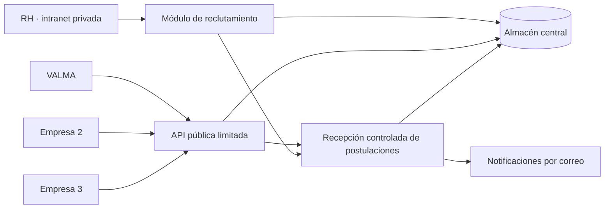

# Estándar corporativo de vacantes y postulaciones

**Versión:** 1.0 · **Estado:** propuesta para implementación · **Fecha:** 2026-11-09

## 1. Propósito y alcance

Definir cómo la intranet corporativa administrará vacantes y postulaciones para varias empresas, y cómo sus páginas web consultarán la información. Recursos Humanos (RH) registra una vacante una sola vez y decide en qué empresas se publica; cada sitio conserva su propia identidad visual.

Este documento es una propuesta técnica: **las rutas, respuestas y funcionalidades descritas aún no están implementadas ni desplegadas**. La intranet existente será la autoridad de los datos; las páginas serán clientes de la API y no tendrán copias editables independientes de las vacantes.

## 2. Contexto confirmado

- La intranet dispone en su repositorio local de una arquitectura Node.js/Express, módulos, empresas y permisos. Su estado y configuración reales en producción se verificarán antes de integrar o desplegar.
- El sitio de VALMA está previsto para `https://ingenieriavalma.com`; su correo de solicitudes es `direccion@ingenieriavalma.com`. El dominio y la recepción de correo deben verificarse antes de la puesta en producción.
- La web actual de VALMA es estática: sus vacantes son de ejemplo y las postulaciones abren el correo del visitante. El formulario de contacto prepara un correo; no envía automáticamente.
- Se contempla la integración de tres páginas. Los nombres, dominios y responsables de las otras dos empresas están pendientes de confirmar.

## 3. Arquitectura y límites



- **Privado:** crear, editar, publicar y cerrar vacantes; revisar candidatos y descargar CV. Se usan la autenticación y los permisos de la intranet, extendidos según sea necesario.
- **Público:** consultar exclusivamente vacantes publicadas para una empresa y recibir postulaciones mediante rutas específicas. Nunca exponer sesiones, datos internos, candidatos ni archivos de la intranet.
- La API pública se publicará mediante un origen y proxy por definir. Si la intranet está protegida por un acceso externo, se habilitarán solo las rutas públicas necesarias, sin desproteger el resto de la aplicación.
- Los sitios no necesitan las credenciales administrativas de la intranet. CORS limita qué navegadores pueden leer las respuestas, pero no sustituye autenticación, autorización ni controles contra abuso.

## 4. Modelo de información propuesto

### Empresa

Identificador interno estable `companyId`, clave pública única `companySlug`, nombre y configuración de notificaciones. Ejemplo de clave para VALMA: `valma`. La relación con las empresas existentes de la intranet debe resolverse por ID, no por nombre visible.

### Vacante

| Campo | Uso |
| --- | --- |
| `id` | Identificador estable generado por el servidor. |
| `titulo`, `descripcion`, `requisitos` | Contenido revisado por RH y apto para publicación. |
| `ubicacion`, `modalidad` | Ubicación y modalidad visibles al público. |
| `companyIds` | Empresas seleccionadas para publicar la misma vacante. |
| `estado` | `borrador`, `publicada`, `cerrada` o `archivada`. |
| `publicadaEn`, `cierraEn`, `actualizadaEn` | Fechas en UTC con formato ISO 8601; `cierraEn` puede ser `null`. |

Una vacante cerrada, archivada, vencida o no asignada a una empresa no debe aparecer en su consulta pública. El cierre o edición debe reflejarse en los sitios según la política de caché acordada. El historial de cambios se mantiene en la intranet.

### Postulación

Identificador, vacante, empresa de origen, fecha, datos necesarios del candidato, referencia privada al CV, aviso de privacidad presentado y estado de seguimiento. Los campos concretos, estados de RH y plazos de conservación se definirán con RH antes de implementarlos. No almacenar CV ni datos sensibles en el código, archivos públicos, URLs o registros técnicos.

## 5. API pública propuesta · v1

**Base:** `https://<origen-publico-por-definir>/api/publica/v1`. Los ejemplos son contratos propuestos; el origen y los nombres finales se confirmarán antes de su publicación. Solo HTTPS en producción. Las respuestas son JSON UTF-8 y las fechas usan ISO 8601.

### 5.1 Listar vacantes de una empresa

```http
GET /api/publica/v1/empresas/valma/vacantes?limit=20&offset=0
```

Respuesta `200 OK` de ejemplo:

```json
{
  "data": [
    {
      "id": "vac_01ejemplo",
      "titulo": "Ingeniero biomédico",
      "ubicacion": "Zacatecas",
      "modalidad": "presencial",
      "descripcion": "Instalación y mantenimiento de equipos médicos.",
      "requisitos": ["Experiencia con equipos médicos"],
      "publicadaEn": "2026-11-09T18:00:00Z",
      "cierraEn": null,
      "actualizadaEn": "2026-11-09T18:00:00Z"
    }
  ],
  "pagination": { "limit": 20, "offset": 0, "hasMore": false }
}
```

`limit` tendrá máximo fijado por servidor y `offset` no será negativo. Una empresa válida sin vacantes devuelve `200` con `data: []`; una clave de empresa desconocida devuelve `404`. Nunca incluir correos internos, información de candidatos, rutas de archivos ni campos administrativos. El cliente debe tratar los textos como texto, no como HTML confiable.

### 5.2 Consultar detalle

```http
GET /api/publica/v1/empresas/valma/vacantes/{vacanteId}
```

Devuelve `200` con `{ "data": { ... } }` solo si la vacante está publicada, vigente y asignada a la empresa. En otro caso devuelve `404` sin revelar si existe para otra empresa.

### 5.3 Recibir una postulación

```http
POST /api/publica/v1/empresas/valma/vacantes/{vacanteId}/postulaciones
Content-Type: multipart/form-data
```

El formulario enviará los campos aprobados por RH, el CV y la constancia de aceptación del aviso de privacidad vigente cuando corresponda. El servidor comprobará que la vacante esté vigente y asignada a la empresa, validará y limitará los datos y archivos, y guardará la postulación antes de confirmar su recepción.

Respuesta `201 Created` de ejemplo, sin datos personales:

```json
{ "data": { "id": "post_01ejemplo", "estado": "recibida" } }
```

El correo de notificación es una operación separada de la recepción: un fallo del correo no debe borrar ni duplicar una postulación guardada. El envío debe registrar su estado, permitir reintentos seguros y alertar a operaciones ante fallos. Definir y probar un mecanismo de idempotencia para reintentos antes de abrir el formulario al público.

### 5.4 Errores y disponibilidad

| Estado | Significado |
| --- | --- |
| `400` | Formato o parámetros inválidos. |
| `404` | Empresa o vacante pública no disponible. |
| `413` | Archivo o solicitud demasiado grande. |
| `415` | Formato de archivo no permitido. |
| `422` | Datos recibidos pero inválidos; devolver errores de campos sin información sensible. |
| `429` | Límite de solicitudes excedido; incluir `Retry-After` cuando aplique. |
| `503` | Servicio temporalmente no disponible. |

Forma común: `{ "error": { "code": "VALIDATION_ERROR", "message": "Revisa los datos enviados." } }`. No devolver trazas, rutas internas ni detalles de seguridad. Los sitios mostrarán estados de carga, sin vacantes y error con opción de reintentar; no deben presentar vacantes vencidas como vigentes si el servicio falla. La política de caché y su tiempo máximo se definirán y probarán según la necesidad de actualización.

## 6. Administración privada y seguridad

1. Integrar el módulo en la intranet existente; definir permisos explícitos para crear, publicar, cerrar y consultar postulaciones, y restringir empresas según el rol.
2. Registrar acciones administrativas relevantes sin contraseñas, cuerpos de CV, datos personales innecesarios ni secretos en los logs.
3. Proteger las rutas privadas con sesión, autorización por módulo y empresa, y defensas apropiadas para las operaciones autenticadas. La API pública no debe reutilizar las sesiones de RH.
4. Aplicar límites de tamaño y frecuencia, controles contra abuso y validación en servidor. Permitir solo formatos de CV aprobados, comprobar su contenido real y nombre, generar nombres internos y guardar fuera del directorio público; analizar archivos antes de ponerlos a disposición según la solución de seguridad elegida.
5. Cifrar el tránsito, proteger los archivos y respaldos con acceso restringido, definir retención y eliminación con RH, y probar restauración. Revisar el aviso de privacidad antes de recopilar datos.
6. Guardar credenciales del servicio de correo y otros secretos en configuración segura del servidor, nunca en Git. Confirmar la entrega y la identidad del remitente durante la puesta en marcha.

## 7. Integración de cada sitio

- Configurar la URL pública de la API y la clave de empresa por entorno. VALMA usa `valma`; las demás claves se asignarán al confirmar las empresas.
- La página consulta el listado al cargar, utiliza identificadores estables y presenta el detalle sin modificar datos en la intranet.
- El botón de postulación abre el formulario real cuando la recepción esté implementada. Hasta entonces, conservar el flujo de correo existente e indicar que el visitante debe enviarlo desde su aplicación.
- No incrustar secretos ni datos de RH en JavaScript, HTML o almacenamiento del navegador. No confiar en validaciones solo del cliente.
- Añadir una empresa nueva mediante configuración y autorización, sin duplicar el módulo central.

## 8. Implementación y verificación por etapas

1. **Descubrimiento:** identificar las otras empresas, sus dominios, usuarios de RH, responsable de cada bandeja y servidor Ubuntu; revisar la intranet y el acceso realmente desplegados.
2. **Módulo privado:** modelo, permisos, edición, selección de empresas, publicación y auditoría. Evaluar la persistencia existente y sus límites antes de decidir una migración de base de datos.
3. **Lectura pública v1:** publicar solo vacantes vigentes; integrar VALMA y probar actualización, cierre, paginación, caché, errores y aislamiento entre empresas.
4. **Postulaciones:** formulario, almacenamiento privado, validación de archivos, permisos, control de abuso, notificaciones, respaldos y pruebas de recuperación.
5. **Piloto y expansión:** probar con datos de prueba y luego conectar las otras páginas. Antes de producción, validar DNS/TLS, correo, privacidad, monitoreo, respaldo y plan de reversión sin afectar otros servicios del servidor.

**Criterios mínimos de aceptación:** una vacante compartida aparece solo en las empresas elegidas; una edición o cierre se refleja dentro del plazo de caché acordado; una postulación válida queda vinculada a su empresa y vacante; RH autorizado puede verla y terceros no; un fallo de correo no pierde ni duplica la solicitud; los estados vacíos y fallos son comprensibles en escritorio y móvil.

## 9. Decisiones pendientes

- Empresas restantes, dominios, mapeo a `companyId` y responsables de RH.
- Origen público de la API, proxy, políticas de acceso y caché.
- Campos de candidatura, formatos y límites de CV, aviso de privacidad y tiempos de conservación.
- Servicio de correo, remitentes, destinatarios por empresa y política de reintentos.
- Modelo de permisos, volumen esperado y evaluación de persistencia y respaldo.
- Fecha de implementación, entorno de pruebas y responsables de aprobación y despliegue.
