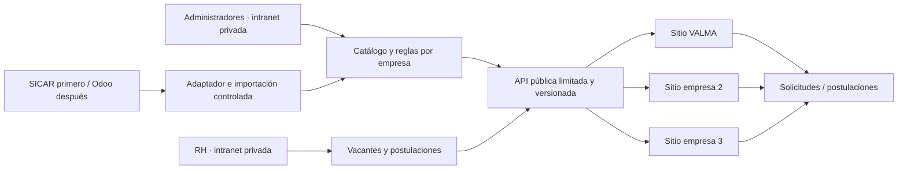

# Guía corporativa para sitios web y catálogo compartido

**Versión:** 1.1 · **Estado:** propuesta para implementación · **Fecha:** 2026-11-09

## 1. Objetivo

Guiar la creación y evolución de tres sitios de empresas del corporativo. Cada empresa tendrá sus propios contenidos, imagen, dominio y oferta; la intranet proporcionará las funciones y datos compartidos que cada sitio tenga autorizados, como vacantes y un catálogo de artículos para sus tiendas.

**Este documento no representa funcionalidades ya implementadas.** Describe una propuesta para definir y construir. Se prevé extraer inicialmente el catálogo de SICAR y cambiar posteriormente a Odoo; las reglas comerciales, alcances de las tiendas, conexiones y fechas siguen pendientes de definición.

La guía complementa [Estándar corporativo de vacantes y postulaciones](ESTANDAR_VACANTES_CORPORATIVAS.md), que detalla el contrato de vacantes. Si una decisión cambia, se deberá actualizar el documento responsable y mantener coherentes ambas guías.

## 2. Contexto conocido

- La intranet corporativa cuenta en su repositorio local con una arquitectura modular Node.js/Express, empresas y permisos. Hay que verificar la instalación real y su configuración antes de intervenir producción.
- El dominio previsto para VALMA es `https://ingenieriavalma.com` y el correo de contacto indicado es `direccion@ingenieriavalma.com`.
- VALMA tiene hoy una página estática, una tienda en mantenimiento y vacantes de ejemplo. Los formularios de contacto y postulación abren la aplicación de correo del visitante; aún no hay API ni tienda integrada.
- Las otras dos empresas, sus dominios, repositorios, responsables, contenidos y reglas comerciales están pendientes de identificar.
- El responsable indicó que la fuente inicial del catálogo será SICAR, mediante un servicio de extracción, y que posteriormente será Odoo. No se ha confirmado la fecha del cambio ni el mecanismo exacto de acceso a ninguno de los dos sistemas.
- La documentación local de la intranet describe una herramienta de migración SICAR que extrae datos en modo lectura y permite actualizar un catálogo local desde archivo. Evaluar qué partes pueden reutilizarse; esa herramienta no constituye todavía una sincronización automática para las tiendas.

## 3. Principio: identidad propia, servicios compartidos

| Cada empresa define | La plataforma central puede compartir |
| --- | --- |
| Nombre, logotipo, identidad visual, textos y navegación. | Empresas, permisos, administración y auditoría. |
| Quiénes son, servicios, cobertura y pruebas verificadas. | Vacantes y postulaciones autorizadas. |
| Datos de contacto, canales de atención y políticas aplicables. | Catálogo maestro, importaciones y medios autorizados. |
| Qué artículos y vacantes mostrar, y su presentación aprobada. | Reglas configurables de publicación, notificación y consulta. |
| Dominios, información legal y responsables de aprobación. | Infraestructura y monitoreo, sujetos al diseño final. |

No asumir que las tres empresas ofrecen los mismos productos, atienden a los mismos clientes ni comparten precios, inventario, correo, razón social o condiciones. No copiar afirmaciones, fotos, certificados o testimonios de una empresa a otra sin autorización y evidencia.

## 4. Arquitectura propuesta



- La intranet es el centro privado de administración y la fuente autorizada de lo que se publica; el sistema de origen del catálogo puede ser distinto.
- Cada página consulta únicamente los datos públicos autorizados para su empresa mediante una API versionada. Los sitios no reciben credenciales administrativas.
- El servidor público expone solo las rutas expresamente necesarias; ni la intranet, ni sus sesiones, ni el catálogo interno completo quedan abiertos por esta integración.
- La capa pública puede ser un servicio independiente o una parte aislada de la intranet detrás de un proxy. La topología, el control de acceso y el origen público se deciden tras revisar el servidor real y los servicios existentes.

## 5. Guía de construcción de cada página

1. **Ficha por empresa:** razón social y nombre comercial, audiencia, objetivos, dominio, responsables, correo y teléfono confirmados; no publicar información no aprobada.
2. **Contenido y diseño propios:** recopilar logotipo, imágenes autorizadas, servicios, cobertura, textos legales, accesibilidad y pruebas de cada empresa. Aprobar el contenido y su navegación con el responsable.
3. **Secciones según necesidad:** inicio, empresa, servicios, contacto, vacantes y tienda cuando correspondan. Una sección compartida no obliga a que todas las páginas tengan las mismas secciones o textos.
4. **Configuración por entorno:** dominio de API, `companySlug` y opciones públicas; mantener secretos solo en el servidor. Utilizar claves de empresa estables relacionadas internamente con el ID de la intranet.
5. **Consumo seguro:** mostrar texto como texto, validar URLs y medios autorizados, manejar carga, ausencia de resultados y fallos; no confiar en el navegador para precios, permisos o disponibilidad.
6. **Publicación:** validar móvil, escritorio, navegación, formularios, contenido, dominio, HTTPS, monitoreo y reversión. Acordar quién puede aprobar y publicar cada sitio.

## 6. Catálogo compartido y visibilidad por empresa

### 6.1 Modelo conceptual

Un **artículo maestro** representa una entidad identificada de forma estable. Una **oferta por empresa** decide si ese artículo aparece en su tienda y con qué datos comerciales autorizados. La relación admite que un artículo aparezca en una, dos o tres tiendas sin duplicar toda su información.

| Dato | Regla propuesta |
| --- | --- |
| `sourceSystem`, `externalId`, `sku` | Identificar origen y artículo; definir alcance y unicidad del SKU por fuente o empresa. No usar el nombre como identificador. |
| `productId` | ID interno estable asignado por la plataforma central. |
| Nombre, descripción, categoría, marca, imágenes | Datos maestros revisados; las adaptaciones por empresa se permiten solo con reglas y responsables claros. |
| Estado del maestro | Borrador, activo o archivado; importar no equivale a publicar. |
| Asociación por empresa | `companyId`, visibilidad, estado editorial y orden; cada empresa publica solo sus artículos autorizados. |
| Precio y moneda | Por empresa, canal y vigencia cuando corresponda. No inferir que las empresas comparten precios o condiciones. |
| Disponibilidad | Por fuente, almacén, empresa o canal según se confirme; registrar momento de actualización y no prometer existencias en tiempo real sin comprobarlo. |
| Variante / presentación | Identificador y atributos cuando aplique; definir relación con unidades, precio e inventario de origen. |

Cada campo tendrá una fuente de autoridad y prioridad de actualización. El sistema no sobrescribirá silenciosamente las ediciones comerciales aprobadas de una empresa. Los valores no proporcionados permanecerán pendientes, no se convertirán en cero ni en afirmaciones públicas.

### 6.2 Fuentes: SICAR primero y Odoo después

La integración usará un **modelo interno común** y adaptadores por sistema. El adaptador de SICAR extraerá y convertirá los artículos al modelo corporativo durante la primera etapa. Más adelante se construirá y probará un adaptador de Odoo que produzca el mismo modelo; las tres páginas seguirán consumiendo la API corporativa y no necesitarán conectarse directamente a ninguno de los dos sistemas.

- El adaptador de SICAR será de lectura para este alcance. Antes de automatizarlo, revisar la extracción existente, dónde está instalado SICAR, cómo accederá el servidor Ubuntu y qué datos y permisos están disponibles. No asumir acceso directo, compatibilidad o actualización en tiempo real.
- La futura conexión de Odoo, su versión, despliegue, permisos y mecanismo de integración se definirán y verificarán cuando corresponda; no se presupone que ya exista ni que tenga la misma estructura de datos.
- Mantener una tabla de correspondencia por fuente (`sourceSystem`, `externalId` → `productId`) y reglas verificadas para relacionar artículos de SICAR y Odoo. Una coincidencia de SKU o nombre no debe fusionar artículos automáticamente sin política y revisión.
- Preparar una migración con extracción de muestra, mapeo, comparaciones de conteos y campos, identificación de duplicados y conflictos, conciliación por empresa y aprobación de responsables. Mantener IDs internos y asociaciones aprobadas donde se confirme que representan el mismo producto.
- El cambio de fuente requiere prueba en paralelo sin publicaciones duplicadas, punto de corte acordado, una única fuente activa por campo o alcance, respaldo y reversión documentada. No activar Odoo en producción ni retirar SICAR hasta validar equivalencias, disponibilidad, seguridad y resultados.
- Registrar origen, lote y fecha de sincronización; vigilar fallos y datos desactualizados. La fuente de inventario, precios e imágenes, la frecuencia y la resolución de conflictos se definirán por empresa antes de la publicación.

### 6.3 Importación segura

1. Autorizar y documentar el acceso inicial a SICAR: propietario, frecuencia, campos y límites. Revisar la herramienta existente y mantener el acceso de extracción en lectura. Los archivos pueden servir para pruebas o contingencia si se acuerda; Odoo será una etapa posterior.
2. Recibir un lote identificable; comprobar formato, tamaño, codificación, columnas, IDs, unidades, moneda y fechas. Mapear columnas al modelo y detectar duplicados, cambios, errores e imágenes faltantes.
3. Generar **vista previa** con altas, cambios, conflictos, artículos rechazados y efecto por empresa. No publicar ni modificar la fuente durante la vista previa.
4. Aplicar solo con permiso de la persona responsable; registrar quién, cuándo, fuente, versión y resultados. Aislar fallos por registro y permitir reintento sin duplicar artículos.
5. Mantener las ofertas en borrador hasta revisión y aprobación de cada empresa. Un artículo nuevo o ausente de una importación no debe aparecer, desaparecer ni cambiar de precio en las tres tiendas automáticamente sin una regla de negocio aprobada.
6. Conservar evidencia, historial y respaldo; permitir revertir un lote sin perder cambios posteriores. Registrar el resultado sin exponer costos, credenciales ni datos privados en logs públicos.

Para actualizaciones automáticas, acordar frecuencia, reconexión, alerta, detección de datos desactualizados y qué hacer ante una importación parcial o fallida. La última importación correcta no equivale a garantía de inventario actual.

## 7. API pública de catálogo · propuesta v1

**Base:** `https://<origen-publico-por-definir>/api/publica/v1`. Son ejemplos propuestos, no rutas disponibles. Todas las respuestas se filtran por empresa y solo incluyen datos aprobados para el público. HTTPS en producción; fechas ISO 8601 UTC.

### Listado y detalle

```http
GET /api/publica/v1/empresas/valma/articulos?limit=20&offset=0
GET /api/publica/v1/empresas/valma/articulos/{productId}
```

Ejemplo de respuesta `200` del listado:

```json
{
  "data": [
    {
      "id": "prod_ejemplo_001",
      "nombre": "Equipo médico de ejemplo",
      "sku": "EJ-001",
      "descripcion": "Descripción aprobada para esta empresa.",
      "categoria": "Equipos médicos",
      "imagenUrl": null,
      "precio": null,
      "disponibilidad": "consultar",
      "actualizadoEn": "2026-11-09T18:00:00Z"
    }
  ],
  "pagination": { "limit": 20, "offset": 0, "hasMore": false }
}
```

`precio: null` y `disponibilidad: "consultar"` significan que no hay una oferta pública confirmada; no equivalen a precio cero o disponibilidad garantizada. Si se autoriza mostrar precio, definir su estructura y moneda con precisión decimal, impuestos, vigencia y reglas por empresa antes de implementarlo. El detalle devuelve `404` si no existe una oferta pública vigente para esa empresa, sin revelar si existe en otra. Un catálogo vacío devuelve `200` con `data: []`.

Los filtros, orden, búsqueda, límites, formato de imágenes, caché y tiempo máximo de actualización se especificarán y probarán antes de fijar el contrato. Errores tendrán un formato consistente, por ejemplo `{ "error": { "code": "NOT_FOUND", "message": "Artículo no disponible." } }`; no incluir trazas ni detalles internos. La API nunca devuelve costos, datos de proveedores privados, credenciales, inventario no autorizado o precios de otras empresas.

## 8. Alcance de las tiendas y solicitudes

El uso de la palabra **tienda** no decide por sí solo cómo se vende. Cada empresa debe confirmar si tendrá únicamente catálogo y contacto, solicitud de cotización, carrito y pedido, o pago en línea. No habilitar checkout ni afirmar disponibilidad o precios hasta que las reglas y servicios estén implementados y probados.

Si se incluyen solicitudes, cotizaciones o pedidos, definir empresa responsable, datos mínimos, destinatarios, seguimiento en intranet, autorización, privacidad, confirmación al cliente y tratamiento de fallos. El servidor debe validar oferta, precio y disponibilidad de nuevo en el momento acordado; prever concurrencia, reservas de inventario cuando corresponda e idempotencia para evitar pedidos duplicados. Los impuestos, facturación, entrega, devoluciones, pagos y políticas comerciales quedan pendientes de definición con cada empresa.

El correo es una **notificación**, no el único registro de una solicitud que el sistema confirme como recibida. Guardar primero el registro y gestionar reintentos/alertas de correo. Mientras no exista recepción automática, comunicar claramente que un enlace `mailto:` abre el correo del visitante y requiere que este lo envíe.

## 9. Seguridad y operación

- Intranet y administración: autenticación, permisos por empresa y función, registro de acciones y revisión periódica de accesos.
- Rutas públicas: datos mínimos por empresa, validación en servidor, límites de tasa y tamaño, protección contra abuso y respuestas sin información interna. CORS no reemplaza autorización.
- Archivos e imágenes: verificar origen, derechos, tipo y tamaño; almacenar y servir de forma controlada. CV y otros documentos privados nunca deben estar bajo rutas públicas.
- Secretos, correo y fuentes: configuración segura por entorno; no guardar contraseñas ni claves en Git o en la página.
- Operación Ubuntu: revisar servicios existentes, segmentar acceso, usar HTTPS, supervisión, respaldos y pruebas de restauración. Documentar despliegue y reversión antes de tocar producción.
- Si el catálogo o inventario falla o queda desactualizado, informar al visitante sin prometer existencias ni compras que no puedan confirmarse.

## 10. Plan por fases y criterios de aceptación

1. **Descubrimiento:** inventariar las tres empresas y sitios, la intranet desplegada, instalación y acceso de lectura a SICAR, responsables, permisos, canales de contacto y alcance comercial de cada tienda; registrar los requisitos conocidos para el futuro cambio a Odoo.
2. **Modelo y publicación:** definir IDs, asociación por empresa, edición y aprobación de contenidos, permisos y API pública. Diseñar los límites de persistencia y concurrencia en función del volumen real.
3. **Importación piloto:** cargar un lote pequeño de prueba, revisar mapeo, duplicados, vista previa, errores, auditoría, respaldo y reversión sin afectar datos reales.
4. **VALMA piloto:** conectar catálogo y vacantes autorizadas, mantener la tienda en estado coherente con sus funciones reales y verificar estados vacíos, errores, accesibilidad y vistas móviles.
5. **Resto de empresas:** conectar los otros sitios con configuración y contenido propios; probar el aislamiento entre empresas y la publicación/retiro de artículos y vacantes.
6. **Operación y lanzamiento:** probar postulaciones o pedidos según alcance aprobado, entrega de notificaciones, seguridad, restauración, dominios, monitoreo y plan de reversión antes del despliegue.
7. **Migración futura a Odoo:** implementar su adaptador cuando el sistema y sus permisos estén disponibles; conciliar y probar en paralelo, aprobar un corte y conservar una reversión, sin cambiar el contrato público de las páginas salvo una versión acordada.

Se considera aceptable cuando un artículo compartido se importe una vez y se publique solo en empresas autorizadas; sus ajustes por empresa no se mezclen; cambios y retiros respeten la política de actualización; ningún costo o dato privado aparezca en la API; un fallo o reintento no duplique registros; los sitios comuniquen correctamente datos ausentes y fallos; y el equipo pueda restaurar un respaldo probado.

## 11. Preguntas pendientes

- ¿Cuáles son las otras dos empresas, dominios, sitios y responsables?
- ¿Dónde está instalado SICAR y cómo accederá de forma segura el servicio Ubuntu a sus datos en modo lectura? ¿Qué campos, imágenes y existencias se podrán extraer y con qué frecuencia?
- ¿Cuándo estará disponible Odoo, qué instalación se usará y cómo se homologarán productos, empresas, almacenes y precios con los identificadores existentes de SICAR?
- ¿Cuáles artículos, imágenes, precios, existencias y almacenes corresponden a cada empresa? ¿Quién aprueba publicación y cambios?
- ¿Qué modalidad comercial tendrá cada tienda: consulta, cotización, pedido o pago? ¿Cómo se manejarán impuestos, stock, envío, facturación y devoluciones?
- ¿Qué se notificará por correo, a qué destinatarios y qué solicitudes se registrarán en la intranet?
- ¿Cuál será el origen público de la API, la frecuencia de sincronización, política de caché y procedimiento de recuperación?
- ¿Quién aprueba contenido, requisitos de privacidad, permisos, pruebas y despliegue para cada empresa?
